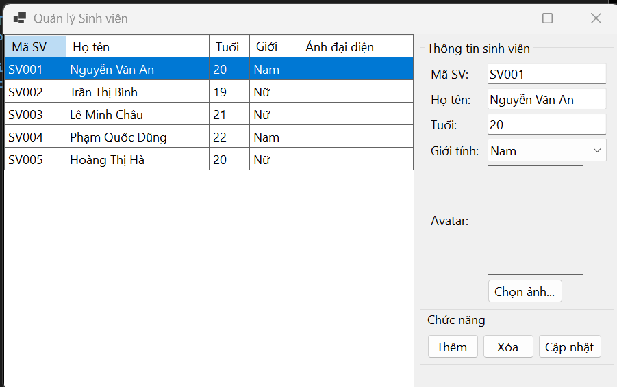
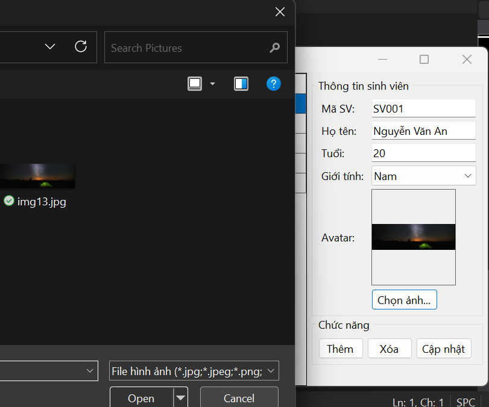
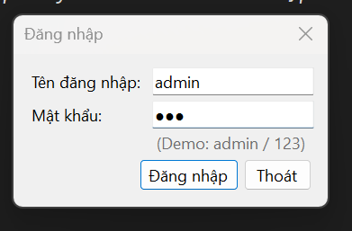
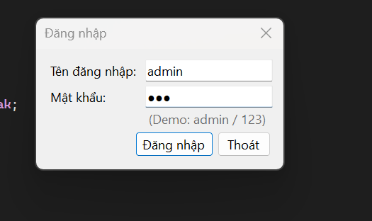
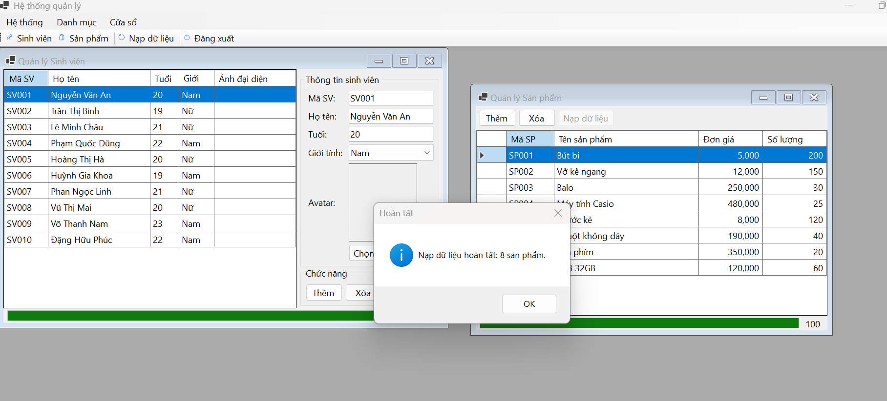

# BÁO CÁO BÀI TẬP NGÀY 12/10/26

## THÔNG TIN SINH VIÊN
- **Họ và tên:** Trần Thế Hào
- **Mã số sinh viên:** 24810320120
- **Lớp:** D19QTANM1
- **Tên môn học:** Lập trình C# / Windows Forms
- **Tên bài tập:** Bài 4.6 – Bài 4.8

---

## DANH SÁCH BÀI TẬP

| Bài | Tên bài | Thư mục |
|---|---|---|
| 4.6 | QUẢN LÝ DỮ LIỆU VỚI BINDINGSOURCE & XỬ LÝ FILE(AVATAR / CSV) | [Bai46](./Bai4_6) |
| 4.7 | THIẾT KẾ KHUNG ỨNG DỤNG MDI & QUẢN LÝ ĐA CỬA SỔ | [Bai47](./Bai4_7) |
| 4.8 | LẬP TRÌNH BẤT ĐỒNG BỘ (ASYNC/AWAIT) & TIẾN TRÌNH PROGRESSBAR | [Bai48](./Bai4_8) |

---

## KẾT QUẢ THỰC HÀNH

### Bài 4.6 -QUẢN LÝ DỮ LIỆU VỚI BINDINGSOURCE & XỬ LÝ FILE(AVATAR / CSV)

### Bài 4.7 - THIẾT KẾ KHUNG ỨNG DỤNG MDI & QUẢN LÝ ĐA CỬA SỔ

### Bài 4.8 - LẬP TRÌNH BẤT ĐỒNG BỘ (ASYNC/AWAIT) & TIẾN TRÌNH PROGRESSBAR

---
